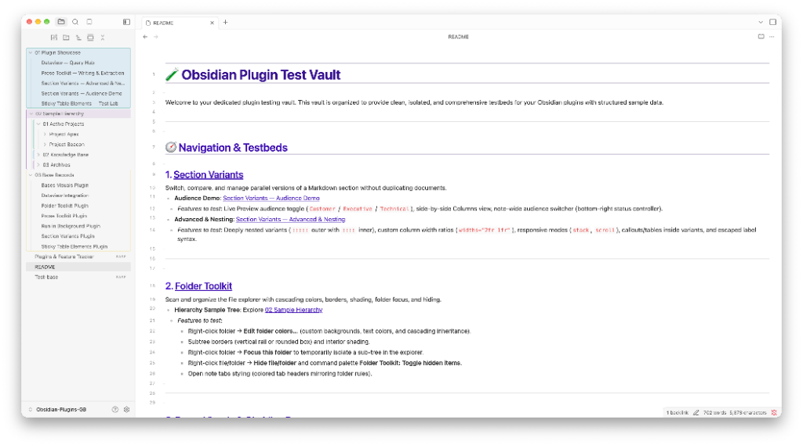

# Folder Toolkit

Folder Toolkit makes Obsidian's file explorer easier to scan and temporarily simplify. It combines independent folder and note colors, cascading folder styles, subtree borders, permanent hiding, and session-only folder focus.

<div align="center">
  <h3>Created by <a href="https://github.com/gabrielbacha">Gabriel Bacha</a></h3>
  <p>
    <a href="https://www.gabrielbacha.com/?utm_source=obsidian_community&amp;utm_medium=referral&amp;utm_campaign=obsidian_assets&amp;utm_content=folder_toolkit_readme_header"><strong>Visit gabrielbacha.com</strong></a>
    &nbsp;·&nbsp;
    <a href="https://obsidian.md/plugins?search=Gabriel%20Bacha"><strong>Explore more Obsidian plugins</strong></a>
    &nbsp;·&nbsp;
    <a href="https://github.com/gabrielbacha/Obsidian-Folder-Toolkit/issues/new?template=feature_request.yml"><strong>Request a feature</strong></a>
  </p>
</div>

## Screenshots



## Features

- Independent text, background, and border colors for folders and notes
- Eight one-click folder-row presets, six subfolder presets, and eight file presets with stable sibling-aware palette assignment
- Conditional font, background, and border colors plus bold and strikethrough styling by file or folder name, with exact, prefix, suffix, and contains matching
- Per-effect folder cascading with explicit inheritance blockers
- Rounded-box or vertical-rail borders around folder subtrees, with optional shaded interiors
- Alternating active-palette borders for direct subfolders
- Optional colored backgrounds or borders on open note tabs
- The same eight switchable palette templates as Bases Visuals, plus custom hex colors and adjustable color strength
- Permanent file and folder hiding with a searchable manager
- A temporary focused-folder view that presents any nested folder as the visible explorer root
- Segment-safe path updates when files and folders are renamed or deleted
- Reattach the appearance of items that were moved outside Obsidian
- Copy the appearance of a file or folder and its contents, and paste it in the same vault or another vault
- Multiple file-explorer panes, desktop, and mobile support
- Efficient differential explorer and tab updates that avoid rewriting unchanged DOM styles

## Usage

Right-click or long-press a file or folder and use the actions in Obsidian's plugin-action group:

- **Edit folder appearance…** or **Edit file appearance…** opens a unified background, border, and text editor with bold, strikethrough, and folder descendant-inheritance controls. New folder treatments start with **Include descendants** off. The folder editor splits presets into two groups that you can combine. **This folder** presets (Grouping folder, Shaded box, Section rail, Minimal label, Highlight, Attention, Muted, and Archived) set only the background, border, and label of the folder row. **Subfolders** presets (Folder only, Inherit colors, Subfolder rails, Shaded rails, Subfolder boxes, and Shaded boxes) set only how that style reaches subfolders and notes. The file editor offers Important, Index note, Tinted, Highlight, Attention, Draft, Done, and Muted presets. Presets sit in a collapsed section below the controls. Each preset button shows a live sample of the item and its contents with that style applied, using the active palette, and its description appears on hover. Palette-based presets pick the first color not already used by a sibling of the same kind. File presets replace the unsaved draft. Each folder preset group replaces only its own settings. All presets remain editable before Save. File borders enclose one explorer row; folder borders and optional shading enclose their subtree. **Clear border** returns to conditional or generated styling, while **No border** explicitly blocks it for that item. Direct subfolders can receive alternating colors from the active palette. Draft changes preview directly in the file explorer; **Save** keeps them and **Cancel** restores the saved rule. The Save and Cancel bar stays visible at the bottom of the editor while you scroll.
- In the appearance editor, **Copy** in the bottom bar copies the style shown in the editor and the saved styles of every item inside the folder. **Paste** loads a copied style into the editor of another file or folder, in this vault or in another vault; **Save** keeps it. For a folder, Save also applies the copied styles of items inside to the items with the same relative path. Items that do not exist under the target are skipped. Styles of other items under the target stay unchanged. Palette colors use the palette of the vault where you paste.
- **Hide file/folder** permanently removes the item from the explorer until hidden items are shown or the path is unhidden.
- **Focus this folder** temporarily hides unrelated branches. Use **Exit folder focus** from a visible folder or the command palette to restore the explorer.

Use **Folder Toolkit: Toggle hidden items** to reveal hidden paths. The settings tab contains the palette selector and a searchable manager for all appearance and hidden-path rules.

Set **Open note tabs** to **Colored background** or **Colored border** to carry each open note's effective cascaded colors into its workspace tab. Text rules color the tab title, while background rules independently color the tab surface or border.

Use **Conditional formatting** in settings to style items by name anywhere in the vault. Choose files, folders, or both; match an exact name or a name that starts with, ends with, or contains a pattern; then enable font color, background color, border, bold, or strikethrough in any combination. Each color has independent palette, custom color, and strength controls. Matching is case-insensitive, and exact or suffix matches work with or without a file extension. Direct item overrides take priority, and the last matching conditional rule wins independently for text color, background color, border, bold, and strikethrough. Muted font rules for `__system` folders, `__archive` file prefixes, and `_basefiles` folder suffixes are enabled by default. Edits to an open rule are a draft that previews in the file explorer; **Save** keeps the changes, and **Cancel** or closing settings discards them. Run **Open conditional formatting rules** from the command palette, or assign it a hotkey in Settings → Hotkeys, to jump straight to these rules.

When a file or folder is renamed or moved, saved rules follow the path and open tabs immediately resolve their appearance from the new folder hierarchy.

Every device that runs Folder Toolkit on a synced vault must have this version loaded. An older version on another device removes the rules when the move reaches it, and Sync then copies the settings without them.

Obsidian cannot see a move made outside it, for example in Finder, with git, or by a sync tool. It reports the move as a delete. For this reason, Folder Toolkit keeps the rules of deleted items. They appear under **Missing items** in the settings manager, grouped by the topmost missing folder. Select **Reattach…**, then pick the item in its new place: the rules of that item and of everything inside it move there. A rule that the new place already has is kept. Select the remove button to discard rules of items that you deleted on purpose. You can also run **Folder Toolkit: Relink missing items** from the command palette. It opens the same list in a dialog.

Folder focus lasts only for the current Obsidian session. Permanent hiding and appearance settings persist.

### Nested vaults

A folder can itself be a vault, for example when one vault holds several others. With **Nested vaults** on (the default), Folder Toolkit finds each nested vault that has its own Folder Toolkit settings and shows its appearance rules, name rules, and palette inside that folder. When you edit an item inside a nested vault, the editor says which vault it saves to, uses that vault's palette, and writes only that item's rule into that vault's settings file. Every other field in the file stays unchanged. If the nested vault does not have Folder Toolkit, the rule is saved in the current vault instead.

- **Vault marker** shows which folders are vaults: a crystal icon before the name, an accent frame around the whole folder, or both (the default). Highlights inside the folder stay inside the frame. A box border set with Folder Toolkit replaces the frame. Every folder that has its own configuration folder gets the marker, even when that vault does not use Folder Toolkit.
- A rule that the current vault saves for an exact path wins over nested rules. A deeper vault wins over an outer one.
- Name rules from a nested vault apply only inside that vault. Hidden paths from a nested vault do not apply.
- A nested vault that is open in another window reloads its settings when this vault writes them. This vault reads nested settings again when its window gets focus, or when you run **Reload appearance from nested vaults**.
- Renaming or moving an item inside a nested vault moves its rules in that vault's settings. Deleting an item leaves the nested settings unchanged. Rules of missing items in a nested vault appear under **Missing items** in that vault's own settings. Obsidian does not update links in the nested vault after a rename made from the outer vault, so rename notes from the vault that owns them.

## Performance

Folder Toolkit updates explorer rows and open-note tabs only when their managed classes or colors actually change. Tab updates are driven by Obsidian workspace and vault events rather than observing every DOM mutation in the workspace, keeping typing and large file explorers responsive.

## Installation

### Community plugins

After approval, install **Folder Toolkit** from **Settings → Community plugins → Browse**.

### Manual installation

Copy `main.js`, `manifest.json`, and `styles.css` into:

```text
<vault>/.obsidian/plugins/folder-toolkit/
```

Reload Obsidian and enable **Folder Toolkit**.

## Privacy

Folder Toolkit works entirely offline. It makes no network requests, collects no telemetry, and never modifies note content or frontmatter. Its stored data contains only vault-relative paths and visual preferences. With **Nested vaults** on, it also reads and writes the Folder Toolkit settings file of vaults that are folders inside the current vault, and nothing else outside the current vault's own settings.

## Development

```bash
npm install
npm run check
```

## License and acknowledgements

Folder Toolkit is MIT licensed. Its independently implemented feature set was inspired by the MIT-licensed File Color and File Hider community plugins.

---

<div align="center">
  <h3>Created by <a href="https://github.com/gabrielbacha">Gabriel Bacha</a></h3>
  <p>
    <a href="https://www.gabrielbacha.com/?utm_source=obsidian_community&amp;utm_medium=referral&amp;utm_campaign=obsidian_assets&amp;utm_content=folder_toolkit_readme_header"><strong>Visit gabrielbacha.com</strong></a>
    &nbsp;·&nbsp;
    <a href="https://obsidian.md/plugins?search=Gabriel%20Bacha"><strong>Explore more Obsidian plugins</strong></a>
    &nbsp;·&nbsp;
    <a href="https://github.com/gabrielbacha/Obsidian-Folder-Toolkit/issues/new?template=feature_request.yml"><strong>Request a feature</strong></a>
  </p>
</div>
